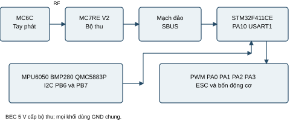

# Đồ án điều khiển quadrotor STM32 với MC6C và MC7RE V2

Bản tích hợp dùng **BlackPill STM32F411CE**, tay phát **MC6C** và bộ thu **MC7RE-V2**.
Bộ thu nối **SBUS qua mạch đảo ngoài tới PA10**. Phần radio nRF24 và tay phát tự chế
đã được thay trong firmware. Đây là bản đã biên dịch và kiểm thử trên máy tính;
chưa xác nhận phần cứng hoặc bay thực tế.

## Tài liệu đồ án

- [Báo cáo thiết kế và triển khai PDF](docs/BAO_CAO_DO_AN_MC6C_MC7RE.pdf)
- [Báo cáo có thể chỉnh sửa](docs/BAO_CAO_DO_AN_MC6C_MC7RE.md)
- [Hướng dẫn đấu dây và sử dụng tiếng Việt](HUONG_DAN_MC6C_MC7RE.md)
- [Các thay đổi so với dự án nền](docs/CHANGELOG_MC6C_MC7RE.md)
- [Kết quả kiểm chứng phần mềm](docs/VALIDATION.md)



## Phần cứng

| Khối | Linh kiện và kết nối |
|---|---|
| MCU | BlackPill STM32F411CE |
| Bộ phát và thu | MC6C + MC7RE-V2; phải xác nhận ghép đôi trên bộ thực tế |
| SBUS | MC7RE S → điện trở 1 kΩ → base NPN; collector → PA10 và kéo lên 3V3 qua 10 kΩ; emitter → GND |
| Nguồn bộ thu | BEC 5 V; nối chung GND với FC |
| Cảm biến | MPU6050, BMP280 và QMC5883P, I2C PB6/PB7 |
| ESC | PA0, PA1, PA2, PA3 tương ứng M1, M2, M3, M4 |
| Còi và LED | PB12 và PC13 |
| Điện áp pin | PB0 qua mạch chia áp đã kiểm tra và hiệu chỉnh |

Cả ba cảm biến đang bắt buộc trong firmware. Không thay QMC5883P bằng module khác
mà không sửa driver. Đối chiếu chân B/C/E theo datasheet transistor thực tế. PA9 được
USART1 giữ nhưng để hở. Ảnh PCB trong thư mục images thuộc phần cứng nRF24 của tác giả;
repo này cung cấp sơ đồ kết nối mới, chưa cung cấp PCB sản xuất mới.

## Kênh và trạng thái động cơ

| Kênh | Chức năng |
|---|---|
| CH1 | Roll ±20 độ |
| CH2 | Pitch ±20 độ |
| CH3 | Vận tốc đứng từ −0,8 đến +1,0 m/s; giữa là 0 |
| CH4 | Yaw ±360 độ/s |
| CH5 | Thấp khóa; cao cho phép cử chỉ arm |
| CH6 | Cao yêu cầu hạ khẩn cấp |

CH3 điều khiển vận tốc đứng, không phải phần trăm công suất động cơ.
Khởi động và nối lại cần thấy CH5 thấp trước khi cho phép ON. Arm bằng ga thấp và
cần pitch gần một đầu hành trình trong 2,1 s khi thân FC gần nằm ngang. CH5 thấp,
mất link hoặc cảm biến không hợp lệ đưa bốn ESC về 1000 µs.

**Chính sách mất link là dừng động cơ:** khi đang bay, máy sẽ rơi. CH6 là yêu cầu hạ
riêng phụ thuộc cảm biến. Phải kiểm tra failsafe bộ thu thật và chấp nhận chính sách
này trước khi bay. Khôi phục sóng không tự bật lại động cơ.

## Biên dịch và kiểm tra

Cấu hình được giữ tại `platformio.ini`: ST STM32 20.0.0, FreeRTOS 10.3.3,
BlackPill F411CE, USB Serial và nạp DFU.

```sh
pio run -e blackpill_f411ce
python tools/run_sbus_tests.py
pio run -e blackpill_f411ce -t upload
```

Bộ test cần trình biên dịch C++ trên máy tính, có thể truyền `--compiler` nếu chưa
nằm trong PATH. Workflow GitHub chạy bộ test và build khi push/pull request.
Thông số PID, hiệu chỉnh từ kế và thang ADC pin kế thừa máy của tác giả; cần chỉnh
cho máy mới. Tháo cánh quạt khi lắp và kiểm tra lần đầu.

## Kiến trúc phần mềm

| Chức năng | Chu kỳ mục tiêu |
|---|---|
| Đọc cảm biến | 1 ms |
| Madgwick và PID tốc độ góc | 2 ms |
| RX SBUS | 2 ms; UART có bộ đệm nhận 128 byte |
| P góc và PI vận tốc đứng | 10 ms |
| Kalman độ cao trong task cảm biến | 5 ms |
| Giám sát pin | 20 ms; công bố mỗi 10 mẫu |
| Watchdog | 200 ms |

Đây là cấu hình mục tiêu; tần số thực, tải CPU, stack/heap phải đo khi nghiệm thu.
Telemetry cảm biến vẫn tính nội bộ; SBUS không gửi phản hồi về MC6C.

## Nguồn dự án và tài liệu thiết bị

Phát triển từ [electrondrift123/stm32-flight-controller](https://github.com/electrondrift123/stm32-flight-controller),
commit `5e0b0876b424970ebf454aec68df33d2ef8dc9d6`. Giữ ghi nhận tác giả mã nguồn gốc
Ayob II M. Tuanadatu trong các file có ghi tác giả.

- [MC7RE-V2 manual gốc lưu tại Device.report](https://device.report/m/aa4ff02c962e9d93241ebc12b489c6b3278a3c1c4446142fa1834557c976935a.pdf)
- [MC6C manual của Microzone lưu tại ManualsLib](https://www.manualslib.com/manual/3364329/Microzone-Mc6c.html)
- [STM32F411 datasheet của ST](https://www.st.com/resource/en/datasheet/stm32f411ce.pdf)
- [2N3904 datasheet của onsemi](https://www.onsemi.com/pdf/datasheet/2n3903-d.pdf)

Manual bộ thu nêu 6C-MINI/C7-MINI/8B-MINI; không suy ra tương thích mọi phiên bản
MC6C chỉ theo tên. Điều kiện triển khai là bộ thực tế ghép đôi được và phát đúng SBUS.
