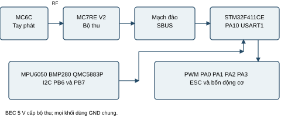
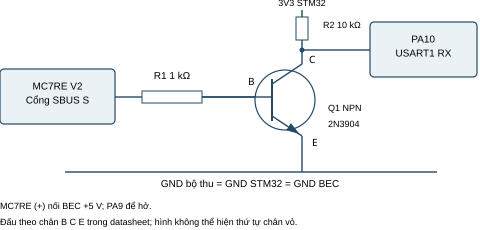
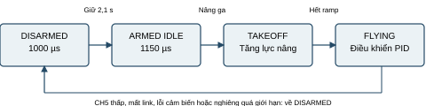

# Bộ điều khiển quadrotor STM32F411CE với MC6C và MC7RE V2

Báo cáo thiết kế và triển khai đồ án
Phiên bản bàn giao ngày 07 tháng 10 năm 2026

Đồ án xây dựng bộ điều khiển quadrotor dựa trên STM32F411CE, FreeRTOS và các cảm biến quán tính, áp suất, từ trường. Phần truyền lệnh được thay từ nRF24L01 và tay phát tự chế sang tay phát MC6C cùng bộ thu MC7RE-V2. Bộ điều khiển nhận các kênh SBUS qua USART1, chuyển thành lệnh tư thế và vận tốc đứng, rồi tạo bốn ngõ PWM cho ESC.

Kết quả bàn giao gồm firmware đã biên dịch, bộ kiểm thử SBUS, hướng dẫn đấu dây, sơ đồ khối, sơ đồ trạng thái và quy trình nghiệm thu. Việc biên dịch và kiểm thử trên máy tính đã đạt. Ghép đôi bộ phát/thu, chất lượng nguồn, đáp ứng ESC, hiệu chỉnh cảm biến và chất lượng bay cần được đo trên mô hình thực tế.

### Mục tiêu và phạm vi

Mục tiêu chính là thay giao tiếp điều khiển trong dự án gốc mà vẫn giữ kiến trúc điều khiển tư thế và vận tốc đứng. Bản sửa bổ sung liên động CH5 khi khởi động hoặc nối lại, khóa động cơ khi mất tín hiệu, đồng thời khắc phục đường xuất PWM khi chưa arm và đường xử lý lỗi cảm biến.

Hệ thống dùng BlackPill STM32F411CE và cấu hình quadrotor 450 mm của dự án gốc. Đây là bản thiết kế kết nối và phần mềm; không có bộ file KiCad/Gerber mới để đặt sản xuất PCB. MC6C là thiết bị thương mại, không cần firmware tay phát tự chế.

### Nội dung báo cáo

1 Kiến trúc hệ thống và lập lịch

2 Phần cứng và nguồn cấp

3 Giao tiếp SBUS và mạch đảo

4 Lệnh điều khiển và liên động

5 Thuật toán điều khiển và PWM

6 Triển khai và cấu trúc mã nguồn

7 Kết quả kiểm thử phần mềm

8 Nghiệm thu phần cứng và kết luận

Nguồn nền: electrondrift123/stm32-flight-controller, commit 5e0b0876b424970ebf454aec68df33d2ef8dc9d6. Tác giả mã nguồn gốc được giữ nguyên thông tin trong các file; bản sửa không thay thế ghi nhận đóng góp của tác giả.

## 1 Kiến trúc hệ thống và lập lịch

MC6C truyền vị trí cần và công tắc bằng liên kết vô tuyến tới MC7RE-V2. Bộ thu phát SBUS, mạch NPN đảo mức logic và USART1 của STM32 nhận chuỗi byte. Lớp giải mã tách kênh, kiểm tra khung và các trạng thái mất tín hiệu. Nhiệm vụ RX chia sẻ một tập lệnh nhất quán với nhiệm vụ điều khiển qua mutex.



### Các nhiệm vụ FreeRTOS

| Nhiệm vụ | Chu kỳ mục tiêu | Vai trò |
| --- | --- | --- |
| readSensorsTask | 1 ms | Đọc cảm biến; cập nhật dữ liệu tư thế và ước lượng độ cao |
| PIDtask | 2 ms | Madgwick, PID tốc độ góc và trạng thái bay |
| RXtask | 2 ms | Đọc bộ đệm UART; cập nhật lệnh và trạng thái link |
| batteryMonitorTask | 20 ms | Đọc ADC pin; công bố trung bình sau 10 mẫu |
| watchdogTask | 200 ms | Làm mới IWDG khi trạng thái cảm biến hợp lệ |
| blinkTask | 1 s mỗi mức LED | Hiển thị hoạt động |

Các chu kỳ trên là cấu hình phần mềm, chưa phải số đo thời gian thực. PID tư thế vòng ngoài và điều khiển vận tốc đứng chạy mỗi 5 vòng PID, tương ứng mục tiêu 100 Hz. Khối Kalman trong nhiệm vụ cảm biến chạy mỗi 5 vòng, tương ứng mục tiêu 200 Hz. Tất cả nhiệm vụ đang có ưu tiên 1 như cấu hình nền; cần đo thời gian thực thi và mức dùng stack khi nghiệm thu.

Giải mã SBUS không chạy trong ngắt GPIO nRF24 cũ. Ngắt UART đưa byte vào bộ đệm 128 byte; RXtask xử lý định kỳ. Không có dữ liệu phản hồi vô tuyến từ FC tới MC6C; dữ liệu cảm biến vẫn dùng nội bộ.

## 2 Phần cứng và nguồn cấp

| Khối | Linh kiện | Yêu cầu triển khai |
| --- | --- | --- |
| Điều khiển | BlackPill STM32F411CE | Firmware dành đúng F411CE; mức logic của FC 3,3 V |
| Tay điều khiển | MC6C | Kiểm tra ghép đôi với bộ thu thực tế |
| Bộ thu | MC7RE-V2 | Nguồn ổn áp 5 V; sử dụng cổng SBUS/M.BUS |
| Đảo SBUS | NPN 2N3904; 1 kΩ; 10 kΩ | Điện trở kéo lên 3,3 V; kiểm tra chân B C E |
| Cảm biến | MPU6050; BMP280; QMC5883P | Cả ba đang bắt buộc trong sensors_init |
| Chấp hành | 4 ESC; 4 động cơ; khung quadrotor | Kiểm tra thứ tự ESC, chiều quay và cánh đúng máy |
| Nguồn | BEC 5 V và nguồn 3,3 V phù hợp FC | Chung GND; kiểm tra sụt áp và nhiễu tải |

### Bảng kết nối

| Tín hiệu | Chân FC | Ghi chú |
| --- | --- | --- |
| SBUS qua mạch đảo | PA10 | USART1 RX |
| USART1 TX | PA9 | Để hở; chân được lớp UART giữ |
| I2C SCL / SDA | PB6 / PB7 | Dùng chung cho ba cảm biến |
| ESC1 / ESC2 | PA0 / PA1 | Vị trí theo code: trước trái / trước phải |
| ESC3 / ESC4 | PA2 / PA3 | Vị trí theo code: sau trái / sau phải |
| Còi / LED | PB12 / PC13 | Tín hiệu trạng thái |
| Đo điện áp pin | PB0 | Bắt buộc qua mạch chia áp phù hợp ADC |

Chân + bộ thu nhận 5 V từ BEC, chân - về GND chung và chân S ở cổng SBUS đi vào mạch đảo. Không nối trực tiếp pin LiPo vào nguồn bộ thu hoặc ADC. Chọn bộ chia áp sao cho điện áp PB0 luôn trong giới hạn của ADC kể cả khi pin đầy; đo thực tế và hiệu chỉnh hệ số chuyển đổi.

Cấu hình đo pin hiện kế thừa máy 3S của tác giả: thang quy đổi 12,6 V tại giá trị ADC 2430 và ngưỡng yêu cầu hạ 10,9 V. Các số này không phải thông số chung cho mọi mạch chia áp hoặc loại pin. Không dùng chức năng đo pin trước khi xác nhận đúng điện áp bằng đồng hồ.

Tín hiệu I2C phải có kéo lên 3,3 V. Địa chỉ đang dùng: MPU6050 0x68, BMP280 0x76, QMC5883P 0x2C. QMC5883P không tự thay thế bằng QMC5883L/HMC5883L vì thanh ghi và địa chỉ khác nhau. Driver BMP280 đặt I2C 400 kHz trong hàm khởi tạo; cần kiểm tra độ ổn định với module và dây thực tế.

## 3 Giao tiếp SBUS và mạch đảo



Sơ đồ thể hiện các nút điện B, C, E của transistor và không thể hiện thứ tự chân trên vỏ. Với 2N3904 của onsemi, datasheet xác định các chân emitter, base, collector theo mã chân của đúng package. Phải đối chiếu linh kiện thực tế trước khi hàn. Điện trở kéo lên phải nối 3,3 V của FC.

### Cấu hình giao tiếp

Lớp UART được cấu hình 100000 baud, 8 bit dữ liệu, parity chẵn, 2 bit stop qua SERIAL_8E2. Khung MC7RE-V2 có 25 byte: byte đầu 0x0F, 22 byte đóng gói 16 kênh, byte cờ và byte cuối 0x00. Mỗi kênh dùng 11 bit. Bộ giải mã chỉ dùng CH1 đến CH6 cho các chức năng đồ án.

```text
0x0F | 22 bytes of channel data | flags | 0x00
```

### Thuật toán nhận và phục hồi

Bộ giải mã tìm byte đầu, thu đủ 25 byte, kiểm tra footer cùng các bit cờ dự trữ, sau đó tách từng kênh theo vị trí bit. Khi khung sai, bộ đệm trượt tới ứng viên header tiếp theo để phục hồi. Giá trị 0x0F xuất hiện trong payload không tự cắt một khung đang nhận bình thường.

Cờ failsafe làm khóa ngay trong lần xử lý RX kế tiếp. Cờ lost khiến khung không được dùng để kéo dài link. Khi không có khung khỏe trong 200 ms, lệnh trở về trạng thái khóa. Kiểm tra giới hạn dữ liệu 120 đến 1900 ở sáu kênh cũng hỗ trợ phát hiện dữ liệu không hợp lệ; không thay thế việc đo hành vi failsafe thực tế của bộ thu.

SBUS không mang CRC riêng trong cấu trúc đang dùng. Các kiểm tra header/footer, giới hạn kênh và cờ không đảm bảo phát hiện mọi lỗi bit. Cần kiểm tra nguồn, đảo mức, dây tín hiệu, parity và nhiễu ở mức phần cứng.

## 4 Lệnh điều khiển và liên động

| Kênh | Lệnh | Giới hạn của bản sửa |
| --- | --- | --- |
| CH1 AIL | Roll | ±20 độ |
| CH2 ELE | Pitch | ±20 độ; đảo dấu theo code gốc |
| CH3 THR | Vận tốc đứng | Thấp -0,8; giữa 0; cao +1,0 m/s |
| CH4 RUD | Yaw rate | ±360 độ/s |
| CH5 | Cho phép arm | Thấp khóa động cơ; cao cho phép cử chỉ arm |
| CH6 | Yêu cầu hạ | Cao bật yêu cầu hạ; CH5 khóa có ưu tiên |

Gọi c là số thô SBUS, lệnh chuẩn hóa u = clamp((c - 1000) / 800, -1, 1). Vùng |u| < 0,04 được đưa về 0. Các kênh roll, pitch, yaw được đổi sang radian hoặc radian mỗi giây. Vận tốc đứng bằng 0,8u khi u âm và bằng u khi u không âm. CH3 không phải phần trăm lực động cơ.



Khi khởi động hoặc sau mất link, FC phải thấy CH5 thấp dưới 600 trước khi chấp nhận CH5 cao trên 1400. Khi link khỏe, cảm biến hợp lệ và CH5 cao, giữ ga thấp với |pitch command| trên 18 độ trong 2,1 giây để arm; thân máy phải nằm trong ±10 độ roll/pitch. Arm thành công đưa ESC tới chạy chờ 1150 µs.

Nâng ga khỏi vùng vận tốc dưới -0,70 m/s chuyển từ ARMED_IDLE sang TAKEOFF. Ramp tăng lực nâng trong khoảng 1,3 giây theo code nền. Khi hoàn tất ramp và vận tốc đứng gần 0, trạng thái chuyển FLYING. Ngưỡng nghiêng bảo vệ kế thừa là 75 độ khi đang TAKEOFF hoặc FLYING.

Mất link trong bản sửa làm dừng động cơ ở 1000 µs. Khi đang bay, hành vi này làm máy rơi. CH6 là yêu cầu hạ có chủ động, vẫn phụ thuộc cảm biến và thuật toán giữ vận tốc. Khôi phục link không tự mở động cơ; phải đưa CH5 thấp rồi cao và arm lại.

## 5 Thuật toán điều khiển và tạo PWM

### Ước lượng trạng thái và các vòng điều khiển

MPU6050 cung cấp gia tốc và vận tốc góc; QMC5883P cung cấp từ trường cho bộ hợp nhất Madgwick 9DoF. BMP280 cùng gia tốc đứng hỗ trợ Kalman 3 trạng thái gồm độ cao, vận tốc đứng và bias gia tốc. Các bộ EMA giảm nhiễu trước khi dùng dữ liệu trong vòng điều khiển.

Roll/pitch dùng vòng ngoài P để chuyển sai lệch góc thành tốc độ góc mong muốn. Vòng trong PID điều khiển tốc độ góc; yaw dùng điều khiển tốc độ góc. Vận tốc đứng được đưa vào bộ điều khiển PI. Các hệ số kế thừa cấu hình quadrotor của tác giả, chưa hiệu chỉnh cho máy mới.

Bản hoàn thiện dùng dt = 0,01 s cho PI vận tốc đứng được gọi ở 100 Hz. dt = 0,002 s vẫn dùng cho vòng tốc độ góc 500 Hz. Việc dùng đúng chu kỳ gọi giúp bước tích phân tương ứng với thời gian thiết kế; tần số thực phải được đo để xác nhận.

### Bộ trộn và thứ tự đầu ra

```text
M1 = T + R + P - Y
M2 = T - R + P + Y
M3 = T + R - P + Y
M4 = T - R - P - Y
```

T là lực nâng nền cộng hiệu chỉnh đứng; R, P, Y là hiệu chỉnh các trục theo dấu của code. Sơ đồ trộn chỉ xác định đầu ra phần mềm. Chiều quay động cơ, trục cảm biến và dấu phản hồi phải kiểm tra trên máy thực tế, chưa được suy ra thành xác nhận bay từ các công thức này.

### TIM2 và mức khóa động cơ

TIM2 xuất bốn kênh trên PA0 đến PA3. Clock timer được lấy từ clock APB1 và nhân đôi khi APB1 có prescaler, thay cho giá trị 84 MHz cố định trước đây. PSC tạo tick 1 µs và ARR = 19999 tạo chu kỳ 20 ms. Khi DISARMED hoặc bị khóa, cả bốn CCR ở 1000; khi ARMED_IDLE ở 1150. ESC phải được kiểm tra để xác nhận 1000 µs thực sự là mức dừng.

Các sửa lỗi tích hợp gồm khởi động khóa, chặn arm khi link/cảm biến không hợp lệ, giữ output khi chưa arm, sửa góc giới hạn về radian, không đưa mẫu cảm biến lỗi vào bộ lọc và trả mutex ở nhánh báo lỗi. Đây là kiểm tra logic phần mềm, không phải chứng nhận an toàn bay.

## 6 Triển khai và cấu trúc mã nguồn

| File hoặc thư mục | Nội dung |
| --- | --- |
| src/main.cpp | Khởi tạo phần cứng, cảm biến, SBUS và FreeRTOS |
| lib/main_rx/main_rx.cpp | UART SBUS PA10 và chế độ chẩn đoán |
| lib/main_rx/sbus.h | Giải mã 16 kênh, chuẩn hóa lệnh, timeout và liên động |
| lib/tasks_config/tasks_config.cpp | Nhiệm vụ nhận, PID, cảm biến, pin và watchdog |
| lib/pin_config | Chân kết nối và cấu hình TIM2 |
| test/sbus_test.cpp | Bộ kiểm thử trên máy tính |
| tools/run_sbus_tests.py | Lệnh chạy kiểm thử với trình biên dịch C++ |
| docs và HUONG_DAN_MC6C_MC7RE.md | Báo cáo, sơ đồ và hướng dẫn thao tác |

### Môi trường và nạp firmware

Dùng PlatformIO với môi trường blackpill_f411ce, platform ststm32 20.0.0, STM32duino FreeRTOS 10.3.3. Bộ công cụ đã kiểm tra trên máy bàn giao dùng PlatformIO Core 6.2.0 và ARM GCC 12.3.1. Cấu hình mặc định nạp bằng DFU; đổi upload_protocol sang stlink nếu dùng ST-Link.

```text
pio run -e blackpill_f411ce
pio run -e blackpill_f411ce -t upload
```

Khi nạp lần đầu, tháo cánh quạt và để CH5/CH6 thấp. Đặt bo vào chế độ DFU theo hướng dẫn đúng model BlackPill. Sau khi nạp, FC hiệu chỉnh cảm biến và mới khởi chạy nhiệm vụ. Kiểm tra thông báo USB Serial 115200 trước khi cấp tải động cơ.

### Chẩn đoán và tự động kiểm tra

Thêm -D RC_INPUT_DIAGNOSTICS vào build_flags để in số thô CH1 đến CH6 mỗi 200 ms cùng cờ lost/failsafe. Xác nhận giữa gần 1000, hai đầu gần 200/1800 và tắt mixing. Bỏ chế độ chẩn đoán sau khi kiểm tra vì in dữ liệu cũng chiếm thời gian thực thi.

```text
python tools/run_sbus_tests.py
```

Workflow GitHub chạy kiểm thử host và biên dịch firmware khi có push/pull request. Việc thêm workflow không đồng nghĩa đã có kết quả CI trên GitHub; trạng thái từng lần chạy phải đọc từ hệ thống CI sau khi đưa mã lên.

## 7 Kết quả kiểm thử phần mềm

Các kết quả dưới đây được thực hiện trên máy bàn giao. Kiểm thử host chạy trực tiếp cùng mã lớp SbusParser và RcInput mà firmware dùng, không dùng mô hình giải mã viết lại riêng.

| Hạng mục | Kết quả | Bằng chứng hoặc tiêu chí |
| --- | --- | --- |
| Biên dịch F411CE | Đạt | PlatformIO báo SUCCESS; sinh firmware.bin |
| 2048 khung SBUS | Đạt | Đủ 16 kênh, các vị trí 11 bit, cờ lost/failsafe |
| Phục hồi framing | Đạt | Bỏ byte không phải header; footer sai; mất byte |
| Chuẩn hóa và gán kênh | Đạt | Roll/pitch/yaw/đứng ở giữa và các đầu hành trình |
| Khởi động CH5 cao | Đạt | Lệnh vẫn kill cho tới khi CH5 được thấy thấp |
| Mất link 200 ms | Đạt | Khung lost không kéo dài link; timeout khóa |
| Nối lại CH5 cao | Đạt | Không tự enable; phải thấy CH5 thấp lại |
| Failsafe và ngoài giới hạn | Đạt | Khóa và xóa quyền enable |
| Bộ đếm thời gian tràn | Đạt | Timeout đúng qua vòng millis 32 bit |
| Phần cứng và bay | Chưa thực hiện | Cần nghiệm thu theo chương 8 |

### Tài nguyên sau biên dịch

Bộ nhớ tĩnh được báo cáo trong log biên dịch: RAM 7700 byte trên 131072 byte, Flash 63832 byte trên 524288 byte. Kết quả được ghi trong docs/VALIDATION.md kèm mã băm firmware; tài liệu này là nguồn đối chiếu cho bản nhị phân bàn giao.

RAM trong báo cáo PlatformIO phản ánh dữ liệu tĩnh và các vùng theo bản đồ linker. Nó không chứng minh đủ stack/heap FreeRTOS cho mọi đường chạy. Các mức stack 64 đến 256 word được kế thừa; cần đo high-water mark, tải CPU và độ trễ khi có đủ cảm biến, serial và động cơ.

### Điều kiện tái lập

Chạy công cụ C++ trên máy tính với -std=c++11 -Wall -Wextra -Werror, rồi chạy bộ test. Chạy pio run cho BlackPill F411CE. Mã nguồn, phiên bản phụ thuộc và log tóm tắt phải khớp với bản firmware dùng trên bo. Không suy ra một lần build thành công là bộ thu đã ghép đôi hoặc phản hồi điều khiển đúng dấu.

## 8 Nghiệm thu phần cứng và kết luận

Thực hiện các bước theo thứ tự, ban đầu tháo cánh quạt. Cột trạng thái cần điền sau khi đo; báo cáo không ghi đạt cho phép thử chưa thực hiện.

| Phép thử | Tiêu chí chấp nhận | Trạng thái |
| --- | --- | --- |
| Nguồn và GND | BEC/3V3 đúng mức; GND chung; không sụt áp dưới tải | Chưa đo |
| Ghép đôi MC6C | Bộ thu có tín hiệu ổn định; đúng phiên bản hỗ trợ | Chưa thử |
| Dạng sóng SBUS | Đảo đúng mức; UART nhận khung; kênh không nhiễu | Chưa đo |
| Kênh và dấu cần | CH1..6 đúng; giữa/endpoints phù hợp; không mixing | Chưa thử |
| Khởi động CH5 cao | PA0..PA3 giữ 1000 µs; không tự arm | Chưa đo |
| Arm và CH5 khóa | Arm đúng cử chỉ; CH5 thấp trả về 1000 µs | Chưa thử |
| Tắt tay phát khi arm | FC khóa; kiểm tra cờ và giá trị failsafe thực tế | Chưa thử |
| Ngắt dây/nguồn RX | FC khóa sau timeout cộng trễ lập lịch | Chưa thử |
| Nối lại khi CH5 cao | Động cơ không tự chạy lại | Chưa thử |
| Lỗi cảm biến | Ngừng dùng mẫu lỗi; FC khóa và watchdog xử lý | Chưa thử |
| PWM và ESC | Chu kỳ 20 ms; dừng 1000 µs; thứ tự motor đúng | Chưa đo |
| Tư thế và lực nâng | Dấu phản hồi đúng; PID, từ kế, pin đã hiệu chỉnh | Chưa thử |

Đo lại hiệu chỉnh từ kế vì min/max trong driver đang là giá trị của tác giả. Xác nhận trục NED và hướng gắn IMU, điểm chuẩn độ cao, thang ADC pin, chiều quay động cơ và cánh quạt. Chỉ chuyển sang thử lực nâng có kiểm soát sau khi các phép thử trên đạt và đã chọn chính sách mất link phù hợp.

### Kết luận và hướng phát triển

Việc thay nRF24 bằng MC6C/MC7RE-V2 đã được thực hiện ở lớp nhận lệnh, cấu hình phụ thuộc, khóa động cơ và tài liệu triển khai. Bản đồ án đủ mã nguồn và thiết kế kết nối để lắp, biên dịch và nghiệm thu trên bàn. Mức hoàn thành thực nghiệm dừng ở biên dịch và kiểm thử host; chưa có dữ liệu bay hoặc PCB sản xuất mới.

Các bước tiếp theo là xác nhận ghép đôi, đo failsafe SBUS thật, đo thời gian nhiệm vụ, hiệu chỉnh bộ cảm biến và PID, sau đó thử mô hình với quy trình phù hợp. Nếu cần telemetry hoặc tự động hạ khi mất sóng, phải thiết kế và kiểm thử thêm trước khi thay chính sách dừng động cơ đang dùng.

## Tài liệu tham khảo và thông tin bàn giao

Dự án nền

[https://github.com/electrondrift123/stm32-flight-controller](https://github.com/electrondrift123/stm32-flight-controller)

Manual MC7RE-V2 của Microzone bản lưu PDF

[https://device.report/m/aa4ff02c962e9d93241ebc12b489c6b3278a3c1c4446142fa1834557c976935a.pdf](https://device.report/m/aa4ff02c962e9d93241ebc12b489c6b3278a3c1c4446142fa1834557c976935a.pdf)

Manual MC6C của Microzone bản lưu

[https://www.manualslib.com/manual/3364329/Microzone-Mc6c.html](https://www.manualslib.com/manual/3364329/Microzone-Mc6c.html)

Datasheet STM32F411 của STMicroelectronics

[https://www.st.com/resource/en/datasheet/stm32f411ce.pdf](https://www.st.com/resource/en/datasheet/stm32f411ce.pdf)

Datasheet 2N3903 và 2N3904 của onsemi

[https://www.onsemi.com/pdf/datasheet/2n3903-d.pdf](https://www.onsemi.com/pdf/datasheet/2n3903-d.pdf)

### Đối chiếu nguồn và cấu hình thực tế

Manual MC7RE-V2 là cơ sở cho mức nguồn bộ thu, giao tiếp SBUS và mạch đảo. Bảng tương thích trong manual nêu 6C-MINI/C7-MINI/8B-MINI; việc tương thích mọi phiên bản mang tên MC6C không được xác nhận chỉ từ tên gọi. Kiểm tra đèn kết nối và dữ liệu kênh trên bộ thực tế là điều kiện trước khi arm.

Các tần số nhiệm vụ, giới hạn lệnh, PID, thứ tự motor và ngưỡng pin trong báo cáo được đối chiếu từ mã nguồn bàn giao. Chúng là lựa chọn triển khai của dự án, không phải khuyến nghị phổ quát của nhà sản xuất.

### Nội dung gói đồ án

Mã nguồn PlatformIO, firmware cho F411CE, bộ test C++, workflow kiểm tra, báo cáo PDF, bản báo cáo Markdown có thể sửa, ba sơ đồ SVG, hướng dẫn đấu dây tiếng Việt, bản tổng hợp thay đổi và kết quả kiểm chứng. Không có file thiết kế PCB để đặt sản xuất hoặc số liệu bay chưa đo.

Giữ bản firmware đã dùng khi nghiệm thu cùng mã băm trong VALIDATION.md. Khi thay đổi code, môi trường, cảm biến hoặc chính sách failsafe, biên dịch và chạy lại các phép kiểm tra liên quan trước khi thay bản dùng trên mô hình.
